# Mango-Mail

**域名邮箱** · Cloudflare Workers · 全栈 TypeScript

一个跑在 Cloudflare Workers 上的邮箱分发系统：收信（Email Routing）+ 发信（多服务商可插拔）+ 账号分发（邀请码 / 批量开户）+ 规则分发（Telegram / Webhook / 外部邮箱转发）。

参考设计：[Cloud Mail](https://github.com/maillab/cloud-mail) / [doc.skymail.ink](https://doc.skymail.ink/) / [henna](https://github.com/wcvjk8tnz8-create/henna)。本项目为独立实现，全栈 TypeScript。

全免费额度可跑：Workers Free + D1 + KV + R2（R2 可选）+ Resend 免费版（每月 3000 封）。

部署完成后的面板：


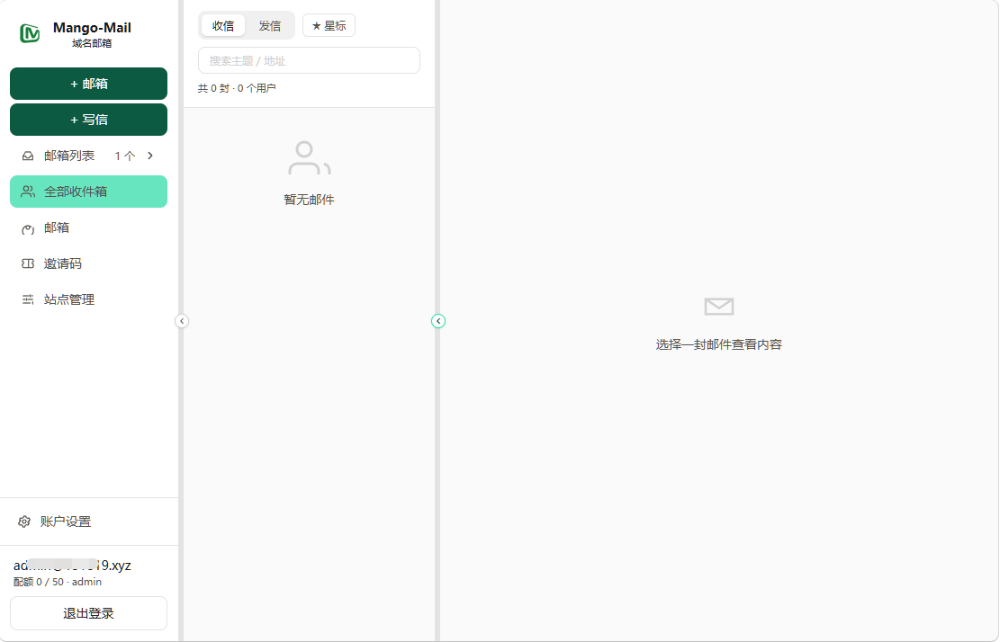

## 能做什么

- 用自己的域名收信、发信
- 多个邮箱地址，邀请码开户
- 发信服务商可换：Resend / SendGrid / Mailgun / Brevo / Postmark / Cloudflare Email Service，失败自动切换
- 分发规则：Telegram / Webhook / 转发到外部邮箱
- 管理员后台：用户与统计、发信日志、分析

## 部署前准备

- 一个 Cloudflare 账号（免费版就行），一个已经托管在 Cloudflare 的域名
- 一个 GitHub 账号
- 一个 Resend 账号（resend.com，免费版每月 3000 封）
- 全程不用写代码，不用在本地装 Git

> 本教程用的是 **Workers Builds（Cloudflare 面板直连 Git）** 部署，push 代码即自动部署。仓库里旧的 GitHub Actions 方式已停用。

---

## 部署教程

### 第 1 步：Fork 本项目

打开本仓库，右上角点 **Fork**，顺手点一颗 Star。

后面部署时选的是你自己 Fork 出来的仓库（`你的用户名/mango-mail`），不是原作者的。

### 第 2 步：新建 3 个资源

**D1 数据库**：Cloudflare 控制台 → Workers & Pages → D1 → Create database，名字填 `mango-mail-db`。

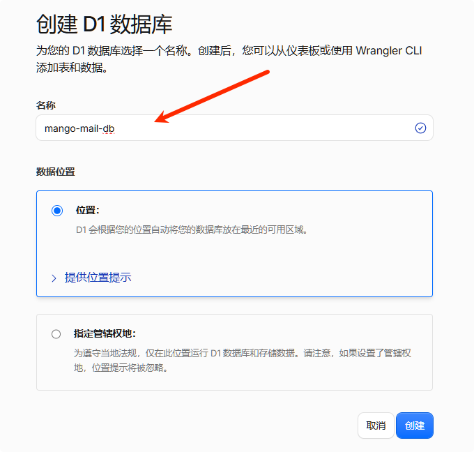

**KV 命名空间**：Workers & Pages → KV → Create a namespace，名字填 `mango-mail-kv`。

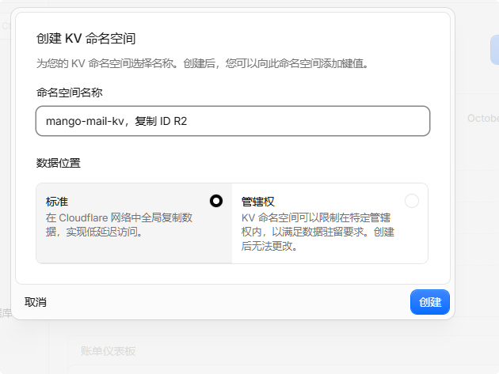

> 名字只填 `mango-mail-kv`，不要多打别的字。

**R2 存储桶**：R2 → Create bucket，名字填 `mango-mail-r2`。

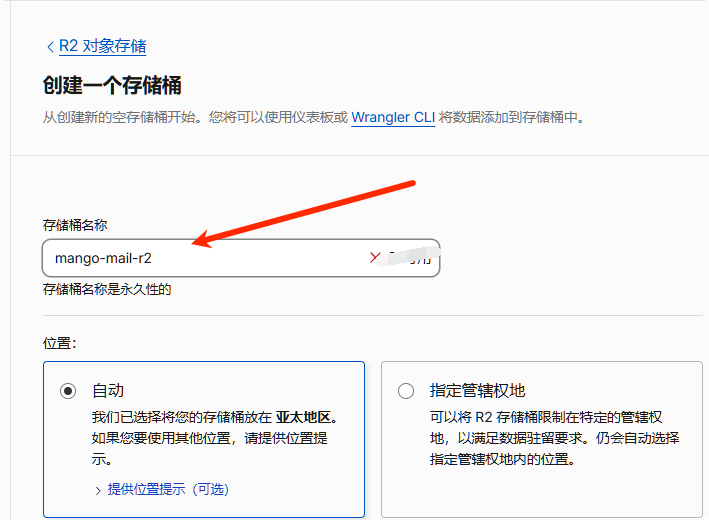

> R2 是唯一可选的资源：免费额度需要绑卡，不想绑卡可以先不建。没有 R2 也能正常部署，收到的邮件附件只登记文件名与大小、不保存内容，收信、发信、规则分发全部照常工作。以后想开附件存储，随时建桶再绑定就行。

### 第 3 步：建 Worker，连 Git（Workers Builds）

Workers & Pages → **创建应用程序** → **Import a Git repository**（导入 Git 仓库）。

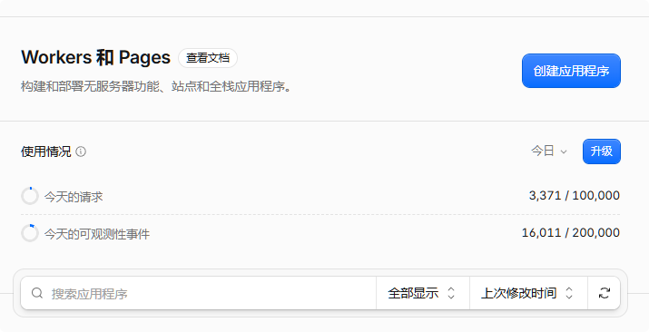

点 **Connect GitHub**，授权后选择你第 1 步 Fork 的仓库（`你的用户名/mango-mail`），分支选 `main`。

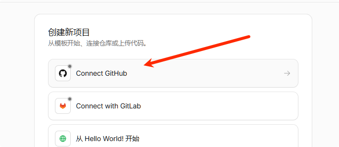

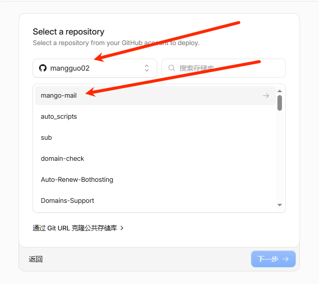

按下表填写，其余留默认：

| 项 | 填什么 |
| --- | --- |
| 项目名称 | `mango-mail` |
| 构建命令 | `npm run build` |
| 部署命令 | `npm run deploy:builds` |
| 预览命令 | `npx wrangler preview`（不动，留默认） |
| 根目录 | `/`（仓库根目录） |

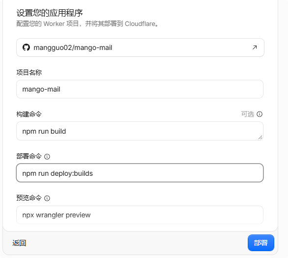

点部署，等构建跑完。全部打勾、显示**已自动部署**就是成功了，记下 Worker 地址（形如 `https://mango-mail.<你的子域>.workers.dev/`）。

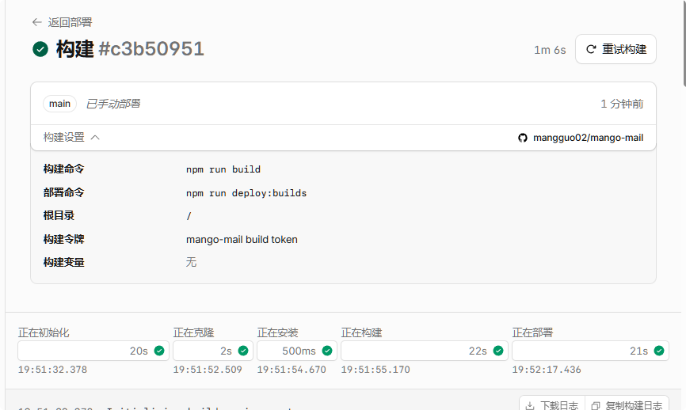

### 第 4 步：绑定 D1 / KV / R2

Workers → `mango-mail` → 设置 → **绑定** → 添加绑定，都选第 2 步新建的资源：

| 绑定类型 | 变量名称 | 选哪个 |
| --- | --- | --- |
| D1 数据库 | `DB` | `mango-mail-db` |
| KV 命名空间 | `KV` | `mango-mail-kv` |
| R2 存储桶 | `R2` | `mango-mail-r2` |

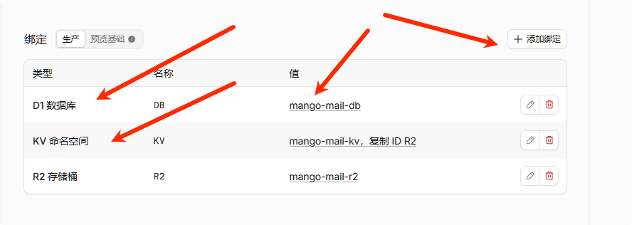

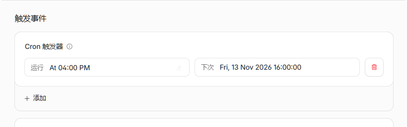

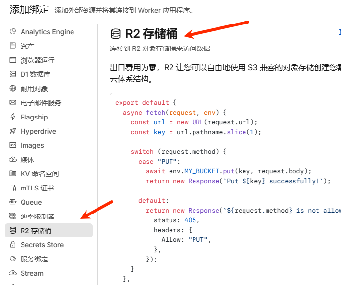

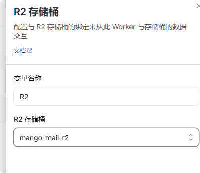

#### 定时任务（Cron 触发器）

部署后去 设置 → Triggers 看一眼，会多一条每天 16:00（UTC）运行的 Cron 触发器，是部署时自动加上的（配置在 `worker/wrangler.jsonc` 的 `triggers.crons`）。

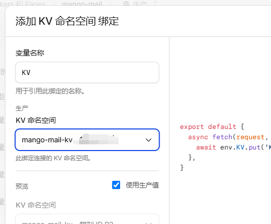

它每天做 3 件事，作用是“每日维护：重置配额与用量、清理过期日志”，触发时间 `"0 16 * * *"`，也就是每天 UTC 16:00，北京时间午夜 0 点跑一次：

1. 用户发信计数清零：`UPDATE user SET used = 0`，把所有用户的当天已发数清零
2. 服务商日用量清零：`UPDATE mail_provider SET daily_used = 0`，把每个发信服务商的当天已用量清零
3. 删 90 天前的发信日志：`DELETE FROM mail_log WHERE created_at < 90天前`，只删日志，不删邮件本身

去掉之后有什么影响：主要是第 1 条。发信的时候，每发一封 `used` 就 +1，`used` 到了配额（默认 50 封）就报 429“发信配额不足”，发不出去。以前每天午夜清零，第二天又能发 50 封；现在不跑了，`used` 只加不减，累计发满 50 封之后就一直发不出去，得手动去 D1 里跑 `UPDATE user SET used = 0` 才能恢复。第 2 条影响不大，只是服务商的日用量统计会一直累计。第 3 条影响也不大，只是 `mail_log` 表会越长越大，D1 慢慢变大。

所以**收信完全不受影响**，发信在 50 封以内也完全正常。这个数字限制可以在变量（`DEFAULT_QUOTA`）中更改。

> 免费账号一个账号最多 5 个 Cron 触发器。如果部署时报 `10072`，就是触发器满了：去别的 Worker 上删一条不用的 Cron 再重新部署；或者删掉 `worker/wrangler.jsonc` 里的 `triggers` 再部署（代价就是上面说的配额不清零）。

### 第 5 步：变量说明、设置

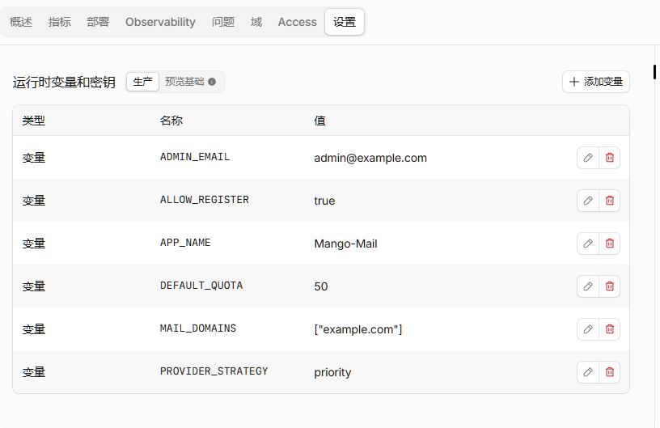

这些变量是部署时从 `worker/wrangler.jsonc` 里的 `vars` 自动加上去的，面板里点铅笔就能改，改完立即生效，重新部署也不会覆盖（`keep_vars: true`）。

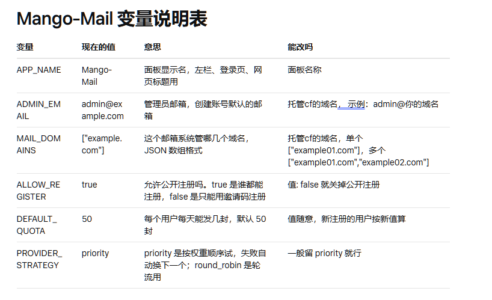

| 变量 | 现在的值 | 意思 | 能改吗 |
| --- | --- | --- | --- |
| `APP_NAME` | `Mango-Mail` | 面板显示名，左栏、登录页、网页标题用 | 面板名称 |
| `ADMIN_EMAIL` | `admin@example.com` | 管理员邮箱，创建账号默认的邮箱 | 填你自己的地址，域名必须在 `MAIL_DOMAINS` 里，例如 `admin@你的域名` |
| `MAIL_DOMAINS` | `["example.com"]` | 这个邮箱系统管哪几个域名，JSON 数组格式 | 单个 `["example01.com"]`，多个 `["example01.com","example02.com"]` |
| `ALLOW_REGISTER` | `true` | 允许公开注册码？`true` 是谁都能注册，`false` 是只能用邀请码注册 | 值：`false` 就关闭公开注册 |
| `DEFAULT_QUOTA` | `50` | 每个用户每天能发几封，默认 50 | 值随意，新注册的用户按新值算 |
| `PROVIDER_STRATEGY` | `priority` | `priority` 是按权重顺序试，失败自动换下一个；`round_robin` 是轮流用 | 一般 `priority` 就行 |

`JWT_SECRET` 不在这张表里，它是机密，要手动加：**添加变量 → 添加机密**，名字填 `JWT_SECRET`，值随便打一个别人猜不到的字符串，不能含 `? % # / \ | &`。

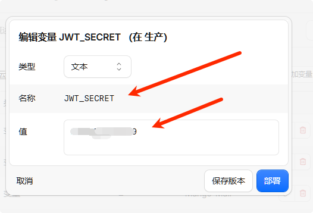

> 注意两点：部署后别改 `JWT_SECRET`，改了会让所有已登录用户被迫重新登录；它同时是第 6 步初始化接口的口令，所以别泄露。

### 第 6 步：初始化建表

打开下面链接（把两处换成你自己的）：

```
https://<你的 Worker 地址>/api/init/<你刚设的 JWT_SECRET>
```

看到 `success` 就说明 **D1 的表建好了**。

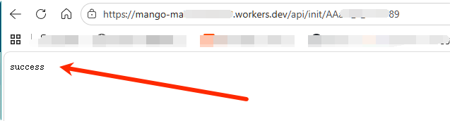

为什么要这一步：新建的 D1 数据库是空的，没有 `user`、`mail_message` 这些表，不初始化就注册会报 `internal error`。初始化只需要跑一次，可以重复跑，不会丢数据。

### 第 7 步：注册账号

打开 Worker 地址，点**创建账号**，用 `ADMIN_EMAIL` 那个邮箱注册，密码自己定（至少 6 位）。

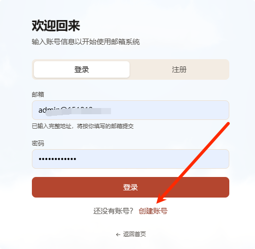

第一个注册的用户自动成为管理员；邮箱前缀是 `admin` 的账号（如 `admin@…`）永远是管理员，后台降不了级。

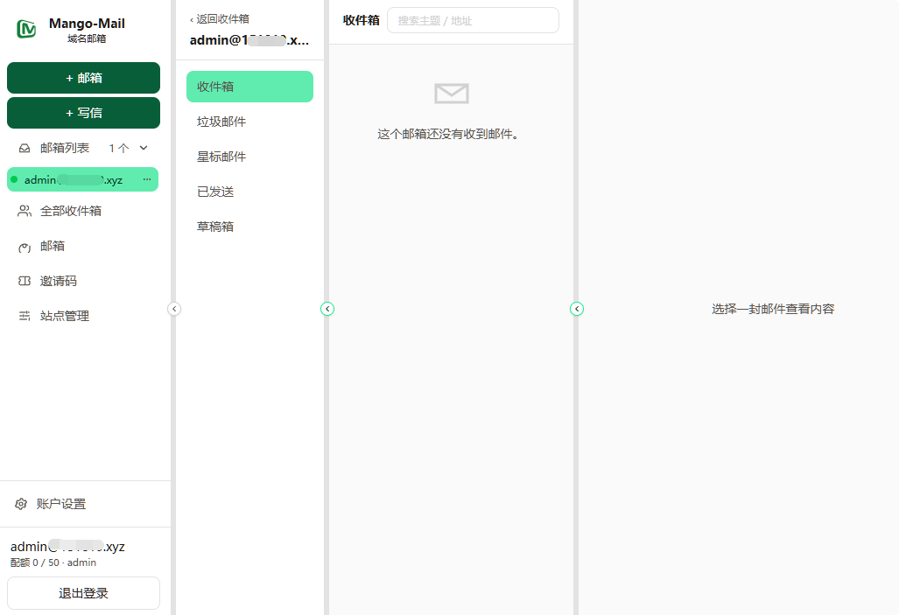

### 第 8 步：启用邮件接收

收信靠 Cloudflare（Email Routing），发信靠 Resend（第 9 步），两个分开配。

1. 回到 Cloudflare 控制台，点击菜单账户主页，再点你的域名。
2. 左边 **电子邮件 → 电子邮件路由**，点**开始使用**。

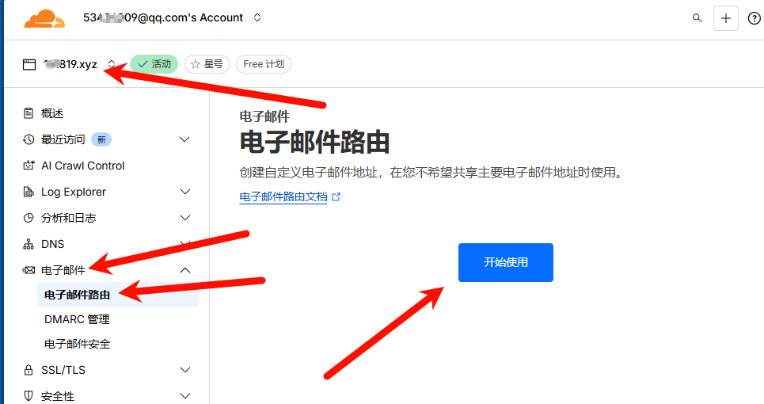

3. 按入站指南把 MX / TXT（SPF、DKIM）记录加上。向导让你填自定义地址时，直接点**跳过**，什么都不用填。

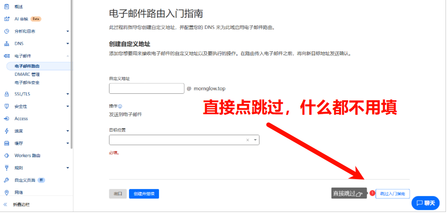

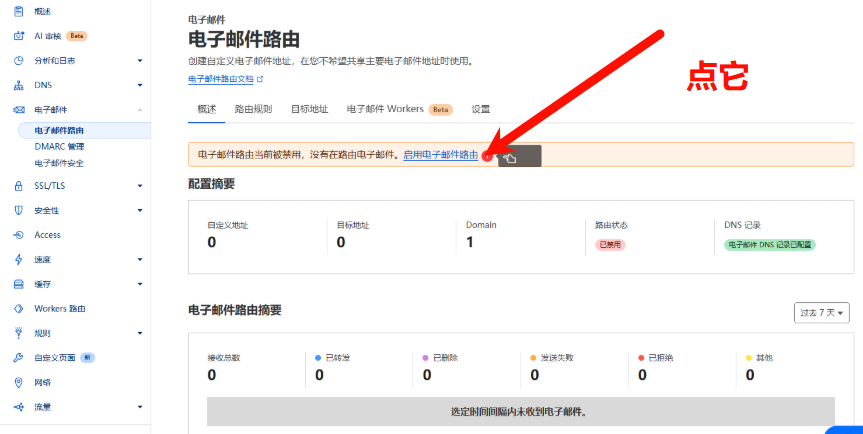

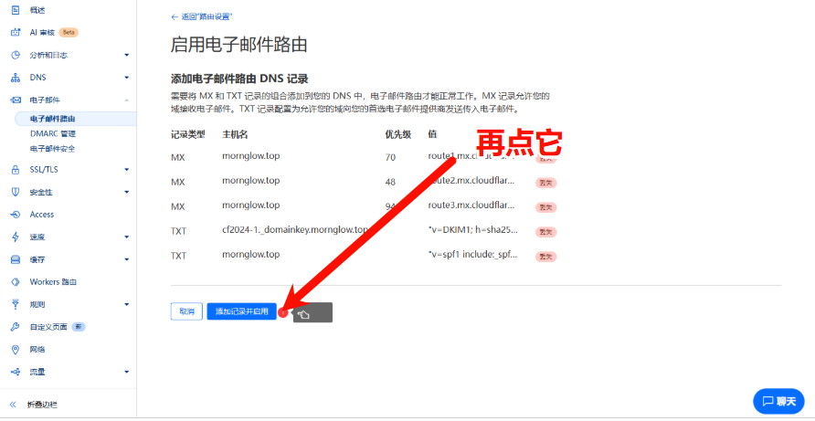

4. **路由规则 → Catch-all → 编辑**：操作选**发送到 Worker**，目标选 **`mango-mail`**，保存。

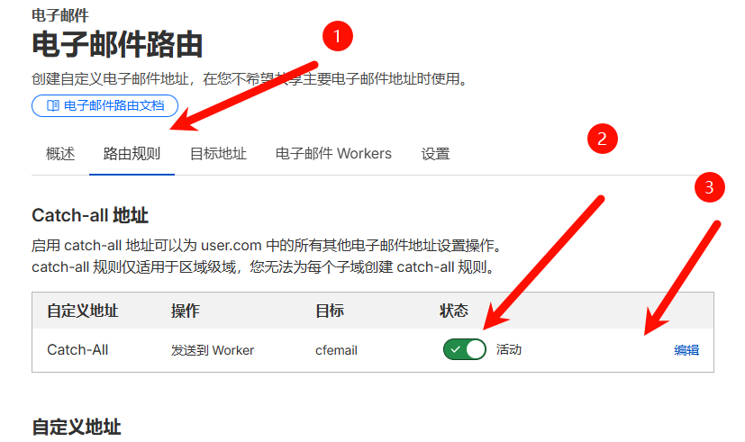

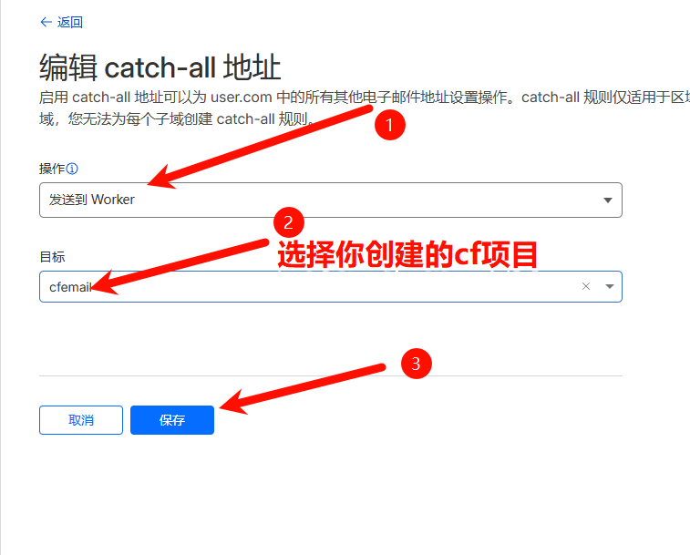

5. 回到**电子邮件 Workers** 看一眼，Catch-All 显示**活动**就是成功了。

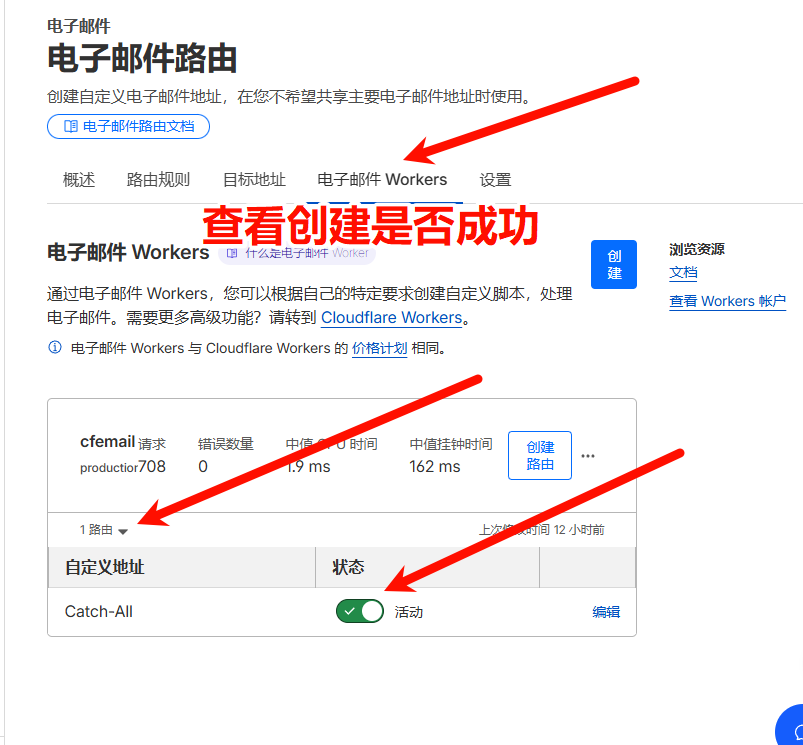

> ⚠️ 一个域名的 Catch-all 同一时间只能指向一个 Worker。上面截图里的目标是 `cfemail`，那是另一个项目（cloud-mail）的 Worker，这里只是借它的界面做演示；**给 mango-mail 收信，目标必须选 `mango-mail`**，否则信会进别的项目，mango-mail 收不到。
>
> 启用后从别的邮箱往你的域名邮箱发一封测试信，面板收件箱里能看到就是通了。

### 第 9 步：配置发信（Resend）

浏览器打开 resend.com 注册账号。

1. 左边 **Domains → Add domain**，输入不带前缀的域名（比如 `151819.xyz`），Region 选离自己近的（Tokyo），点 **Add Domain**。

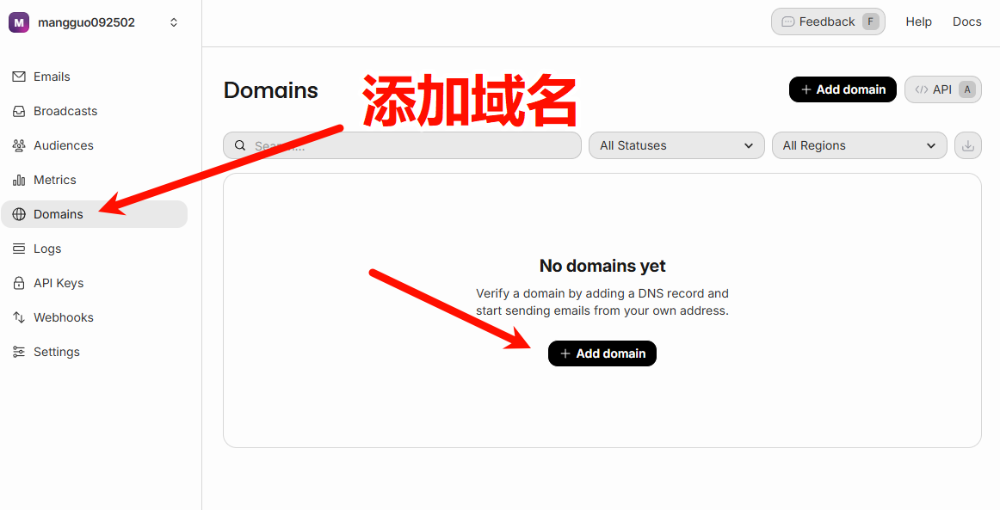

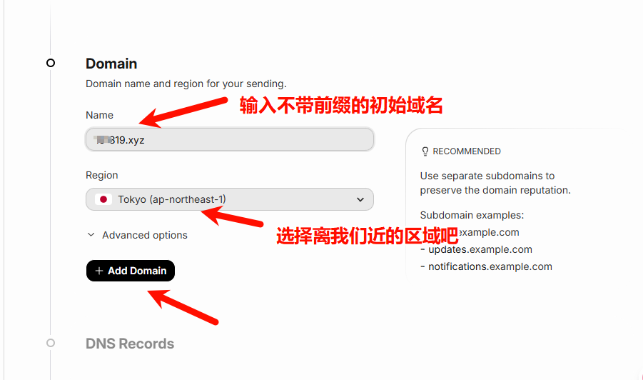

2. 点 **Sign in to Cloudflare**，授权 Resend 自动加 DNS 记录（DKIM、MX、SPF）；也可以点 Manual setup 自己加。

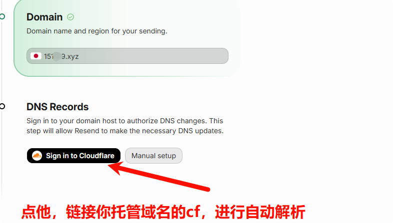

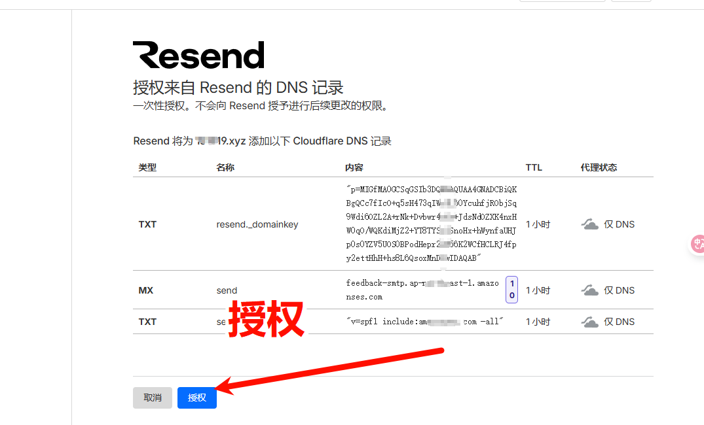

3. 等域名状态变成**已验证**（Verified）。DNS 记录一般几分钟生效。

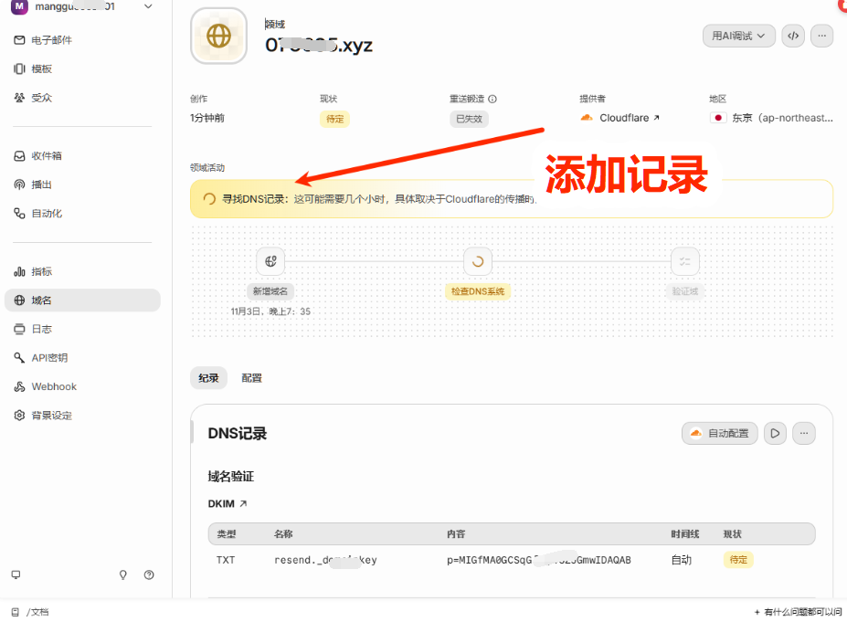

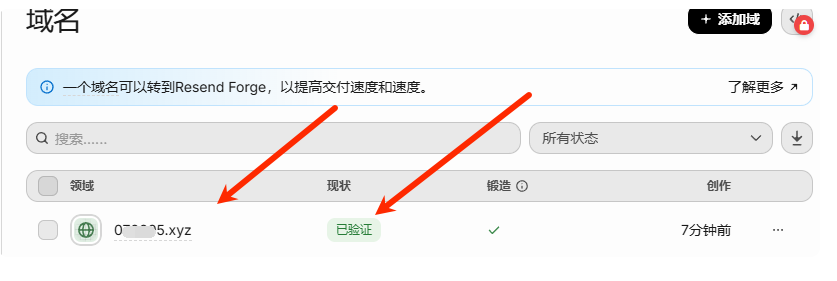

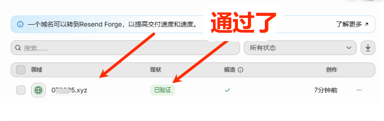

4. 左边 **API Keys → Create API key**：名字随意，Permission 选 **Full access**，Domain 选 **All Domains**，点 Add。

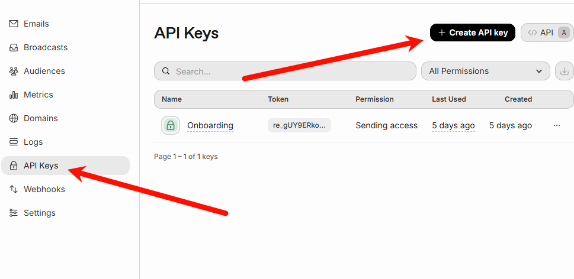

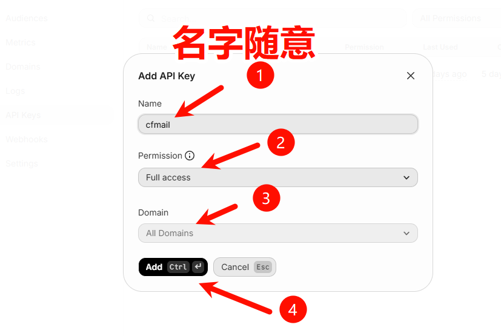

5. 弹出的 Key **只显示一次**，复制保存好。

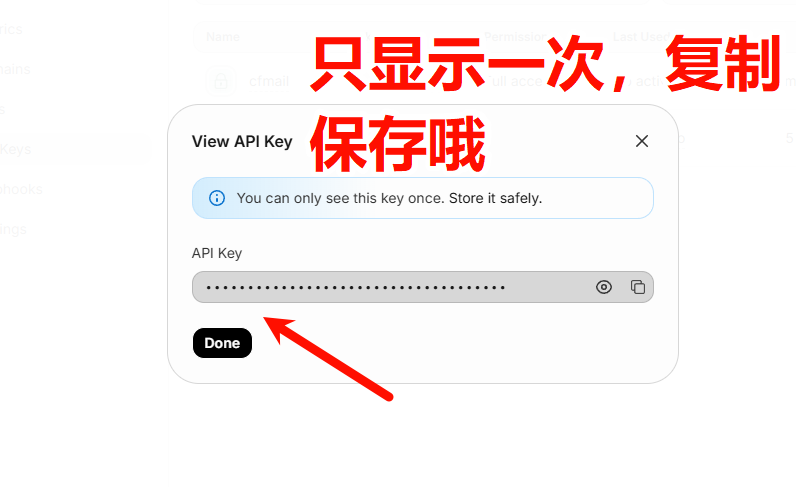

6. 回到 Mango-Mail 面板 → **站点管理 → 发信服务商 → 添加服务商**：类型选 **Resend**，备注名称填你的邮箱，API Key 粘贴刚才复制的，保存。

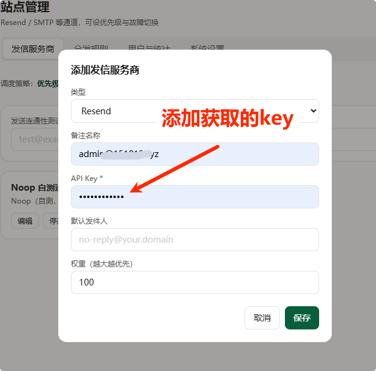

7. 把 **Noop 自测通道停用**。它是假的，不真发信；留着启用会抢走流量。

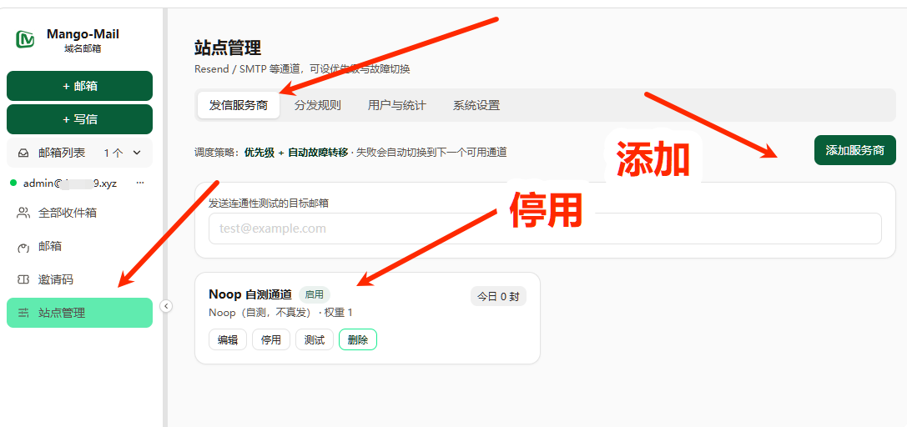

验证：写信页给自己别的邮箱发一封，能收到就是通了。Resend 免费版每月 3000 封。

---

## 部署后检查清单

- [ ] 打开 Worker 地址能注册、登录
- [ ] `/api/init/<JWT_SECRET>` 显示 `success`
- [ ] 从外部邮箱发一封到你的域名邮箱，面板收件箱能收到
- [ ] 从面板发一封到外部邮箱，能收到
- [ ] 设置 → Triggers 里有一条每天 16:00 的 Cron

## 常见问题

- **注册报 `internal error`**：多半是没跑第 6 步初始化，先跑 `/api/init`。
- **发信报 429“发信配额不足”**：当天发满 `DEFAULT_QUOTA` 封了；等午夜 Cron 清零，或去 D1 跑 `UPDATE user SET used = 0`，或把 `DEFAULT_QUOTA` 调大（`-1` 为不限）。
- **部署报 `10072`**：账号 Cron 触发器满 5 个了，见第 4 步。
- **收不到信**：检查 Email Routing 的 Catch-all 目标是不是 `mango-mail`；MX / SPF / DKIM 是不是绿色；`MAIL_DOMAINS` 里有没有你的域名。
- **发不出去 / 进垃圾箱**：检查 Resend 域名是不是已验证；面板里 Resend 通道是不是启用、Noop 是不是已停用。
- **不想绑卡用 R2**：R2 是唯一可选的，不绑也能部署；附件只登记文件名与大小，不保存内容，收发信照常。
- **一个域名能用在两个域名邮箱项目上吗**：收信不行，Catch-all 一次只能指向一个 Worker；发信可以，两个项目都能用同一个域名发（SPF / DKIM 对上就行）。

## 本地开发

```bash
cd worker && npm i && npm run d1:local   # 本地 SQLite 建表
cd worker && npm run dev                 # http://localhost:8787

cd web    && npm i && npm run dev        # http://localhost:5173（代理 /api 到 8787）
```

首次注册的用户自动成为 `admin`。本地只能看界面，Email Routing 收信和真发信要在 Cloudflare 上才行。

## 开放 API

所有 `/api/*` 均可用 `Authorization: Bearer <jwt>` 或 `X-Api-Key: <key>` 调用：

```bash
curl -X POST https://<你的域名>/api/send \
  -H "Authorization: Bearer $TOKEN" \
  -H 'Content-Type: application/json' \
  -d '{"from":"a@你的域名","to":["b@example.com"],"subject":"hi","html":"<b>hi</b>"}'
```

## License

MIT
